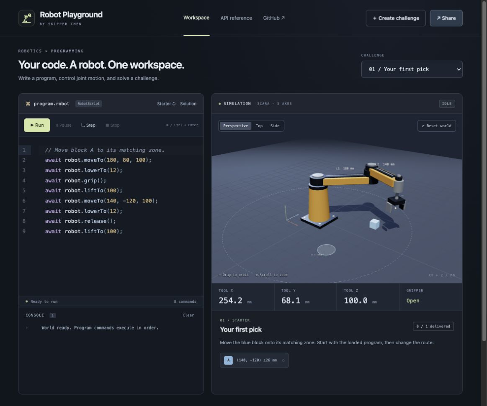

# Robot Playground

Write a program. Move a 3D robot. Share the challenge.

**[Open Robot Playground](https://niceskipperchen-coder.github.io/robot-playground/)** · [Original arm simulator](https://niceskipperchen-coder.github.io/robotic-arm-simulator/)



A browser-based programming environment for a three-axis SCARA-style robot. It combines a CodeMirror editor, a tested command interpreter, and a Three.js workspace. No account or physical hardware is needed.

## Try it

1. Open the playground and press **Run** to deliver the blue block.
2. Use **Pause**, **Step**, and the highlighted source line to follow execution.
3. Try **Sort the colors** or **Precision landing**, or create your own challenge.
4. Press **Share** to send the layout and, optionally, your program to someone else.

Shared programs always open idle. Nothing is executed until the visitor presses Run or Step.

## Features

- CodeMirror editor with syntax coloring, line numbers, autocomplete, local drafts, and Ctrl/Cmd+Enter.
- Deterministic 60 Hz simulation, sequential commands, pause/resume, single-command stepping, stop, and reset.
- Execution highlighting, line-specific errors, and a live console.
- Orbit, pan, and zoom around the robot; perspective, top, and side presets.
- Three built-in challenges with tested solutions, live delivery progress, and per-block goal matching.
- Custom challenge builder for one to three blocks, with reach and layout validation.
- Versioned share links containing the challenge and optional source in the URL fragment. No server, accounts, leaderboard, or analytics.
- Responsive layout and keyboard-accessible editor, execution controls, camera presets, and dialogs.

## RobotScript

RobotScript is a small command language with JavaScript-style syntax. It is **not a JavaScript runtime**: there are no variables, functions, arbitrary expressions, or browser APIs. Source is parsed into a bounded command list; `eval` and `Function` are not used.

```js
// Pick the blue cube up at its center.
await robot.moveTo(180, 80, 100);
await robot.lowerTo(12);
await robot.grip();
await robot.liftTo(100);

// Transfer above the floor, then place it.
await robot.moveTo(140, -120, 100);
await robot.lowerTo(12);
await robot.release();
await robot.liftTo(100);
```

| Command | Behavior |
| --- | --- |
| `robot.moveTo(x, y, z)` | Move the tool; XY radius 40–320 mm, height 12–100 mm |
| `robot.lowerTo(z)` / `robot.liftTo(z)` | Set height, retaining XY |
| `robot.grip()` | Close jaws and attach an aligned block; a missed grasp stops execution |
| `robot.release()` | Open jaws and release any held block |
| `robot.wait(ms)` | Wait 0–5000 ms |
| `robot.home()` | Return to the initial joint pose and 100 mm tool height |
| `robot.log("message")` | Print a quoted message, up to 200 characters |

`await` is optional; all commands execute sequentially. Semicolons are required. Numeric literals, quoted log strings, `//` and `/* */` comments, and `repeat(n) { ... }` are supported. Repeat counts are 1–20, nesting is limited to four levels, expanded programs to 300 commands, and UTF-8 source to 8 KB. Each command has a 15-second simulation-time timeout.

## Challenge rules

Each required block must be inside its own matching goal, released, resting on the floor, and no longer falling. Carrying a block over a target does not count. A program can finish without solving the challenge; completion is reported separately.

Custom layouts support A, B, and C blocks. Their centers and target centers must be 55–295 mm from the base. Start blocks cannot overlap, nor can target zones. Goal radius is 8–35 mm. Share payloads are schema-validated and limited to 16 KB decoded UTF-8; oversized or invalid links leave a usable default challenge.

Anyone who has a share link can read the included program and layout. The URL contains the data; there is no hosted short-link service. Drafts stay in this browser's local storage. Sharing is an explicit action.

## Run locally

Requires Node.js 22+ and Python 3 for the provided local preview command.

```sh
npm ci
npm test
npm run build
npm start
```

Open `http://127.0.0.1:4174`. All runtime assets are served locally; no CDN requests are required. A browser with WebGL 2 is needed for the 3D workspace. `dist/` can be hosted on any static web server, including a GitHub Pages project subpath. The publishing workflow tests and rebuilds the editor before deploying.

## Architecture

```text
src/editor.js       CodeMirror integration and execution/error decorations
src/completion.js   Command-prefix completion replacement
build.mjs           Reproducible local editor bundle

dist/program.js     RobotScript lexer, parser, repeat expansion, source lines
dist/engine.js      Deterministic simulation and execution state machine
dist/challenges.js  Built-ins, validation, progress, share-link encoding
dist/view3d.js      Robot geometry, goals, camera controls, lighting
dist/kinematics.js  Forward/inverse 2R kinematics
dist/motion.js      Speed-limited joint stepping
dist/manipulation.js  Grasp attachment, gravity, and floor contact
dist/app.js         UI coordination, drafts, builder, and sharing
```

Tests cover kinematics, grasp and floor behavior, command grammar and limits, line errors, completion prefixes, Unicode sharing, malformed payloads, challenge validation, pause/step/stop semantics, recovery from errors, final-command gravity, and every built-in solution.

## Model assumptions

The mechanism has two revolute axes and one prismatic tool axis; gripper opening is a separate action. Links are 180 and 140 mm. The model uses 90°/s angular limits and a 65 mm/s vertical limit without acceleration modeling. Rendering runs independently of the 60 Hz simulation.

Cubes are 24 mm. Grasping requires alignment within 8 mm horizontally and 6 mm vertically. Held cubes follow the tool through a simplified attachment constraint. Released cubes experience 9810 mm/s² gravity and inelastic floor contact. Pause and Stop freeze the world; after a program finishes, released cubes can continue settling.

There is no friction, contact-force solver, robot collision checking, stacking, motor torque model, or independent wrist rotation. This is an educational programming simulation, not a physical robot controller.

## References

Created for Skipper Chen's engineering learning portfolio. Experiments, design changes, and learning notes will be documented as the project develops.

The renderer and core robot model extend the [original simulator](https://github.com/niceskipperchen-coder/robotic-arm-simulator). [Robotics Toolbox for Python](https://github.com/petercorke/robotics-toolbox-python) and [Mithi's Hexapod](https://github.com/mithi/hexapod) informed the earlier project's presentation, not its source implementation.

[Three.js / OrbitControls](https://threejs.org/) and [CodeMirror](https://codemirror.net/) are third-party components. Their licenses are included under `dist/vendor/` and `THIRD_PARTY_NOTICES.txt`.
